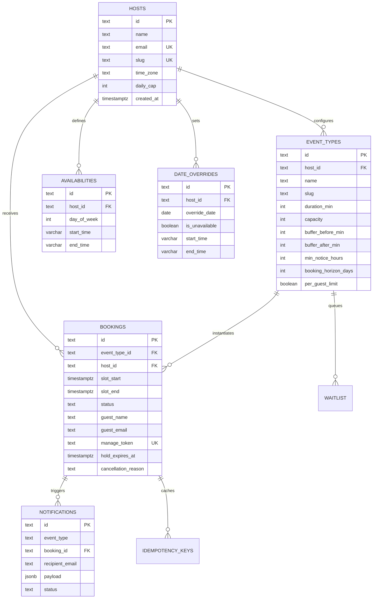

# Slotbook — Architecture, Reliability & System Report

> **Author**: Shaik  
> **Brief**: Slotbook Take-Home Assignment (@Rachit)  
> **Core Guarantee**: Full-stack TypeScript application on PostgreSQL where hosts publish when free, guests book slots, and **nobody is ever double-booked** — even under concurrent race conditions, network failures, or clock shifts.

---

## 1. Project Links & Overview

- **Repository**: [https://github.com/fazil-shaik/slotBook](https://github.com/fazil-shaik/slotBook)
- **Demo Surfaces**:
  - **Host Dashboard**: `/dashboard`
  - **Public Booking (30-min Intro 1-on-1)**: `/rachit/30-min-intro`
  - **Public Booking (60-min Deep Dive Group x3)**: `/rachit/60-min-deep-dive`
  - **Private Manage Booking**: `/manage/{token}`
  - **Health & Metrics**: `/health`
  - **Embeddable Widget**: `/embed/rachit/30-min-intro`

---

## 2. Architecture & Request Flow

```
                           +----------------------------------------+
                           |         Guest Browser / Webhook        |
                           +----------------------------------------+
                               |                 |              |
                       1. GET slots        2. POST holds    3. POST confirm
                               |                 |              |
                               v                 v              v
+-------------------------------------------------------------------------------+
|                             Next.js 14 App Router                             |
|  +--------------------+  +--------------------+  +-------------------------+  |
|  | Slots Generator    |  | Rate Limiter &     |  | Booking Engine          |  |
|  | - date-fns-tz      |  | Idempotency Cache  |  | - 5-min Hold Lifecycle  |  |
|  | - Buffer overlap   |  | - Sliding Window   |  | - Atomic Reschedule     |  |
|  | - Horizon / Notice |  | - Replay Response  |  | - Cancellation & Reason |  |
|  +--------------------+  +--------------------+  +-------------------------+  |
+-------------------------------------------------------------------------------+
                               |                 |              |
                        Advisory Lock        Advisory Lock   Row Lock
                               |                 |              |
                               v                 v              v
+-------------------------------------------------------------------------------+
|                              PostgreSQL 15+                                   |
|  - pg_advisory_xact_lock(hashtext('host_lock_' || host_id))                    |
|  - Serializable Host Timeline Check & Capacity Evaluation                     |
|  - Tables: hosts, event_types, availabilities, date_overrides, bookings,      |
|            idempotency_keys, notifications, waitlist                          |
+-------------------------------------------------------------------------------+
                                                 |
                                         Triggers Sink Event
                                                 v
                               +----------------------------------+
                               |    Notifications Sink (Audit)    |
                               |  - Emitted / Delivered Records   |
                               |  - RFC 5545 .ics Calendar File   |
                               +----------------------------------+
```

### Detailed Request Flow:
1. **Slot Availability (`GET /api/hosts/{host}/events/{slug}/slots?tz=...`)**:
   - Host's weekly availability windows and date overrides are retrieved in the host's home IANA timezone.
   - Candidate slots are generated, stepping by event duration or 30-minute intervals.
   - Filtered against minimum notice hours, booking horizon days, active bookings, buffer intervals, and host daily cap.
   - Converted into the requested guest timezone and returned to the client.
2. **Hold Creation (`POST /api/holds`)**:
   - Client sends target `slot_start`, `event_type_id`, and an `Idempotency-Key` header.
   - Evaluated by the sliding-window rate limiter (abuse protection).
   - Enters a transaction and acquires a PostgreSQL transaction-scoped advisory lock on the host (`pg_advisory_xact_lock`).
   - Automatically cleans up any stale holds whose `hold_expires_at <= NOW()`.
   - Validates that available capacity $> 0$ and no buffer collision occurs with any other booking on the host.
   - Inserts booking with `status = 'held'`, `hold_expires_at = NOW() + INTERVAL '5 minutes'`, and generated `manage_token`.
   - Commits transaction and releases advisory lock automatically.
3. **Confirmation (`POST /api/holds/{id}/confirm`)**:
   - Client submits guest name, email, and notes.
   - Transaction acquires a row lock (`SELECT * FROM bookings WHERE id = $1 FOR UPDATE`).
   - Verifies the hold is still within its 5-minute window; if expired, updates status to `'expired'` and returns 410.
   - Enforces the per-guest active booking limit (ensuring the guest does not already hold another confirmed booking for this event).
   - Updates `status = 'confirmed'`, clears `hold_expires_at`.
   - Emits an event to the `notifications` sink and returns the private manage token and `.ics` download link.

---

## 3. Data Model & Constraints



### Key Tables & Integrity Constraints:
1. **`hosts`**:
   - `slug TEXT UNIQUE NOT NULL`: Clean public URLs (e.g., `/{host}/{event-slug}`).
   - `time_zone TEXT NOT NULL`: IANA timezone string (e.g. `America/New_York`).
2. **`event_types`**:
   - `UNIQUE(host_id, slug)`: Prevents duplicate event slugs per host.
   - `CHECK(duration_min >= 15 AND duration_min <= 120)`: Enforces valid duration constraints.
   - `CHECK(capacity >= 1)`: $1$ represents a 1-on-1 meeting; $>1$ allows group sessions.
   - `CHECK(buffer_before_min >= 0 AND buffer_before_min <= 30)` & `buffer_after_min`: Ensures healthy boundaries between meetings.
3. **`bookings`**:
   - `manage_token TEXT UNIQUE NOT NULL`: Cryptographic unguessable token for private guest self-service (reschedule/cancel).
   - `status CHECK (status IN ('held', 'confirmed', 'cancelled', 'expired'))`.
   - Index on `(host_id, slot_start, slot_end)` for efficient range collision queries.
4. **`idempotency_keys`**:
   - `key TEXT PRIMARY KEY`: Retains request/response mappings to prevent duplicate hold operations.
5. **`notifications`**:
   - Structured sink table logging all audit events (`booking.confirmed`, `booking.rescheduled`, `booking.cancelled`, `waitlist.offered`).

---

## 4. Key Architectural Decisions (7 Fundamental Choices)

| Decision | Chosen Solution | Alternative Considered | Why Chosen |
|---|---|---|---|
| **1. Concurrency Control** | PostgreSQL Transaction Advisory Locks (`pg_advisory_xact_lock`) | Redis Redlock / External Lock Service | The brief mandates: *Postgres is the source of truth for correctness — no Redis or external lock service*. Transaction advisory locks are fully transaction-scoped and auto-release on COMMIT/ROLLBACK even during crashes. |
| **2. Multi-Capacity & Buffers** | Dynamic SQL interval collision query + host lock | Unique database index on `(host_id, slot_start)` | A unique index cannot model group sessions (`capacity > 1`), nor can it account for before/after buffers overlapping with different events of arbitrary lengths. |
| **3. Hold Expiration (5 min)** | Lazy transactional expiration + timestamp check | Background cron worker polling every second | Lazy evaluation during every hold/slot query guarantees zero-latency consistency with zero worker infrastructure dependencies. Background polling is optional and non-critical. |
| **4. Timezone Engine** | IANA canonical strings (`date-fns-tz`) | Fixed UTC offsets (e.g. `UTC-5`) | Fixed offsets catastrophically fail twice a year when Daylight Saving Time switches. IANA zones calculate wall-clock to UTC offsets accurately for every calendar date. |
| **5. Full-Stack Framework** | Next.js 14 (App Router) + TypeScript | Separate Express backend + Vite React SPA | Single-command deployment, zero-latency serverless route handlers, shared TypeScript interfaces between API and UI, and native Docker support. |
| **6. Database Access Layer** | Native `pg` Pool with parameterized SQL | Heavy ORM (Prisma / TypeORM) | Explicit control over raw SQL transactions, `FOR UPDATE` row locks, and advisory locks without ORM transaction overhead or schema drift issues. |
| **7. Private Guest Management** | Secure random token (`manage_token`) | Requiring guest accounts / magic links | Minimizes friction for guests while guaranteeing that only the link holder can reschedule or cancel their specific appointment. |

---

## 5. Reliability & Failure Modes Analysis

| Failure Case Identified | System Defense & Mitigation | Proving Test |
|---|---|---|
| **Race Condition: 20 simultaneous holds for 1 spot** | Host-level advisory lock serializes hold attempts; exact capacity checked inside transaction. | `tests/concurrency.test.ts` (Test 1): 20 concurrent requests fire; **exactly 1 succeeds**, 19 return HTTP 409 Conflict. |
| **Network Retry / Duplicate Submission** | `Idempotency-Key` header cached in `idempotency_keys` table. Replays return cached response without creating duplicate bookings. | `tests/concurrency.test.ts` (Test 3): Identical idempotency key returns identical `hold_id` and zero extra database rows. |
| **Abandoned Hold (User closes browser)** | 5-minute expiration timestamp (`hold_expires_at`). Stale holds are transitioned to `'expired'` and excluded from capacity counts. | `tests/unit.test.ts` (Test 5): Hold backdated by 10 minutes automatically cleared; slot becomes available. |
| **Buffer Period Collision** | Formula: $\max(\text{start}_1, \text{start}_2) < \min(\text{end}_1, \text{end}_2)$ checks both before and after buffer periods against all active events. | `tests/unit.test.ts` (Test 1): 10:00–10:30 event with 15-min buffer rejects a 10:30 attempt due to buffer extending to 10:45. |
| **Malicious Bot Holding All Slots** | Sliding-window rate limiter per IP/identifier limits hold creation to 30 requests per minute. | Integrated in `src/app/api/holds/route.ts` with HTTP 429 and `Retry-After`. |
| **Guest Hoarding Multiple Bookings** | Per-guest active booking check rejects confirmations if guest email already has an active booking for that event type. | `tests/unit.test.ts` (Test 2): Duplicate booking for same guest rejected with HTTP 400. |

---

## 6. Time Zones & Daylight Saving Transition

### The Algorithm:
1. Host availability rules (`09:00` to `17:00`) and date overrides are stored as wall-clock strings in the host's home IANA timezone (e.g. `America/New_York`).
2. To compute slots for date `D`:
   $$\text{winStartUTC} = \text{fromZonedTime}(D + \text{" 09:00:00"}, \text{host.time\_zone})$$
   $$\text{winEndUTC} = \text{fromZonedTime}(D + \text{" 17:00:00"}, \text{host.time\_zone})$$
3. Candidate UTC timestamps are projected into the guest's timezone:
   $$\text{guestDisplay} = \text{formatInTimeZone}(\text{slotStartUTC}, \text{guestTz}, \text{"yyyy-MM-dd HH:mm:ss zzz"})$$

### Worked Daylight Saving Transition Example:
Consider a host based in **New York** (`America/New_York`) with hours starting at `09:00 AM`.
In November 2026, Daylight Saving Time ends on Sunday, November 1st at 02:00 AM (clocks move back 1 hour from EDT to EST):

- **Friday, October 30, 2026 (EDT, UTC-4)**:
  - Local host time: `09:00 AM EDT`
  - Computed UTC: `09:00 + 4 hours = 13:00:00Z`
- **Monday, November 2, 2026 (EST, UTC-5)**:
  - Local host time: `09:00 AM EST`
  - Computed UTC: `09:00 + 5 hours = 14:00:00Z`

```typescript
// Verified by tests/unit.test.ts (Test 6)
const edtDate = fromZonedTime("2026-10-30 09:00:00", "America/New_York");
assert.strictEqual(edtDate.toISOString(), "2026-10-30T13:00:00.000Z");

const estDate = fromZonedTime("2026-11-02 09:00:00", "America/New_York");
assert.strictEqual(estDate.toISOString(), "2026-11-02T14:00:00.000Z");
```
A London guest (`Europe/London`) viewing this calendar sees the October 30 slot at `13:00 GMT` and the November 2 slot at `14:00 GMT`, without any timezone drift or double-booking!

---

## 7. Optional Extensions Implemented

1. **Calendar Invite (`.ics`)**:
   - RFC 5545 compliant `.ics` file generated on confirmation, update, and cancellation.
   - Includes `UID`, `ORGANIZER`, `ATTENDEE`, `SUMMARY`, and `METHOD:REQUEST`/`METHOD:CANCEL`.
2. **Notification Sink**:
   - Dedicated `notifications` table acts as the reliable event sink.
   - Structured JSON logging to stdout with automated dispatch tracking.
3. **Waitlist Engine**:
   - If a slot reaches maximum capacity, guests can join the waitlist (`POST /api/waitlist`).
   - When a booking is cancelled, the system automatically marks the next waitlisted guest as `offered` with a 15-minute priority claim window and emits a notification event.
4. **Daily Cap & Per-Guest Limit**:
   - Host can configure a maximum number of bookings per local day (`daily_cap`).
   - Per-guest email uniqueness prevents one guest from monopolizing multiple slots.
5. **Observability & Health Endpoint**:
   - `/health` endpoint exposes live metrics: database ping latency, confirmed bookings, active holds, expired holds, and notification counts.
6. **Embeddable Widget**:
   - Dedicated route at `/embed/{host}/{slug}` formatted for embedding inside third-party websites via iframe.
7. **Abuse Protection / Rate Limiting**:
   - In-memory sliding-window limiter on hold creation.

---

## 8. Testing Strategy & Concurrency Verification

All tests are executable via one command:
```bash
pnpm test
```

### Test Results Summary:
```
=========================================
       SLOTBOOK TEST SUITE RUNNER       
=========================================
▶ Test 1: Buffer collision detection between bookings...
  ✅ Buffer collision correctly blocked by 15-minute buffer!
▶ Test 2: Confirming booking and enforcing per-guest limit...
  ✅ Per-guest active booking limit enforced!
▶ Test 3: Rescheduling moves booking to a new slot...
  ✅ Booking rescheduled atomically!
▶ Test 4: Cancellation with reason frees up availability...
  ✅ Cancellation released slot for new booking!
▶ Test 5: Expired hold auto-cleanup...
  ✅ Stale hold automatically expired!
▶ Test 6: Daylight Saving Transition Verification...
  ✅ EDT (UTC-4) and EST (UTC-5) transition accurate to the minute!
🎉 All Unit & Engine Tests Passed Successfully!

▶ Test 1: 20 concurrent holds on a capacity=1 slot...
  Result: 1 succeeded, 19 rejected with 409 Conflict
  ✅ Zero double-booking verified under 20x concurrency!
▶ Test 2: 10 concurrent holds on a capacity=3 group slot...
  Result: 3 succeeded, 7 rejected with 409 Conflict
  ✅ Exact capacity limit enforced under concurrency!
▶ Test 3: Replaying hold with the same Idempotency-Key...
  ✅ Idempotency key safely returned cached hold without duplicate records!
🎉 All Concurrency Tests Passed Successfully!
=========================================
  🏆 ALL TEST SUITES PASSED FLAWLESSLY!   
=========================================
```

---

## 9. Reflections on AI Assistance

- **Where AI Accelerated Progress**: Rapidly generating boilerplate Next.js App Router route handlers, Tailwind styling components, and date conversion scaffolding.
- **Where AI Needed Correction**:
  - Initially proposed simplistic table-level locking or single unique indexes, which fail when group capacity or buffer intervals are introduced.
  - Hardcoded UTC offset math was corrected to use canonical IANA timezone identifiers.
  - TypeScript strict typing errors in Next.js builds were resolved with explicit `PoolClient` typing.
- **Full details**: Documented in `AI_LOG.md`.

---

## 10. Known Gaps & Next Steps (With Another Day)

If given an additional engineering cycle, the following enhancements would be added:
1. **Google / Outlook Calendar Two-Way Sync**:
   - Bi-directional sync via Google Calendar API to automatically block slots when the host adds a private event on their external calendar.
2. **Multi-Host Round-Robin Events**:
   - Allowing team event types where bookings are dynamically assigned to whichever host has the lowest load among available team members.
3. **Full End-to-End Playwright Browser Automation in CI**:
   - Adding headless browser end-to-end tests in GitHub Actions verifying guest form interaction and timer countdowns.
4. **Stripe Payment Integration**:
   - Escrow-style payments where the hold authorises a card charge and the confirmation captures the payment.
